# Predicting Diamond Prices: A Reproducible ML Pipeline from Raw Data to a Live App

**AIPI 510 — Module 3: Data/ML Engineering**  
**Author: Hasan Al-Quaid**

| | Link |
| --- | --- |
| **Live front end (Streamlit)** | https://project-diamond-hasan.streamlit.app/ |
| **API test page** | https://diamond-api-168452878253.us-east1.run.app/docs |
| **Clean data (public, Google Cloud Storage)** | https://storage.googleapis.com/diamonds-hasan-aipi510/data/diamonds_clean.csv |

## Project Overview & Goals

This project builds a full machine learning pipeline that predicts the price of a diamond from its features. The goal is not just a AI model, but a **reproducible, deployed** one: the data is cleaned and stored in the cloud, the model is tuned and tracked with MLflow, the model is served by a FastAPI app in a Docker container on Google Cloud Run, and anyone can use it through a public Streamlit website.

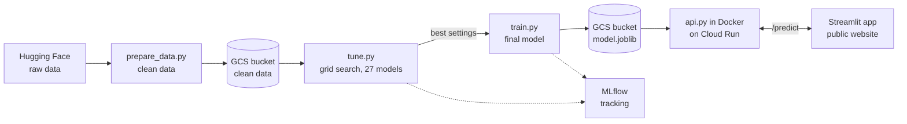

## Problem Definition

- **Goal:** Predict a diamond's price in US dollars.
- **Inputs:** carat (weight), cut, color, clarity, depth %, and table %.
- **Task type:** Supervised regression. The target (`price`) is a known number for every diamond in the training data.
- **Evaluation metric:** Mean absolute error (MAE) on the test set, meaning how many dollars the predictions are off on average. RMSE and R² are also reported.

## Data Description

| | |
| --- | --- |
| Source | [mstz/diamonds on Hugging Face](https://huggingface.co/datasets/mstz/diamonds) |
| Raw file | https://huggingface.co/datasets/mstz/diamonds/raw/main/diamonds.csv |
| Raw size | 53,940 diamonds, 10 columns |
| Clean size | 53,772 diamonds, 10 columns |
| Target | `price` (USD) |

| Column | Meaning |
| --- | --- |
| `carat` | Weight (1 carat = 0.2 grams) |
| `cut` | Cut quality: Fair, Good, Very Good, Premium, Ideal (worst → best) |
| `color` | Color grade: J (most yellow) → D (colorless, best) |
| `clarity` | Clarity grade: I1 (visible flaws) → IF (flawless) |
| `depth` | Total depth % (height ÷ average width) |
| `table` | Width of the flat top as a % of the widest point |
| `x`, `y`, `z` | Length, width, and height in mm |
| `price` | Price in USD |

### Cleaning steps (`src/prepare_data.py`)

| Step | Rows removed | Rows left |
| --- | --- | --- |
| Raw data downloaded from Hugging Face | — | 53,940 |
| Fixed column names (`'x'` → `x`) and text values (`b'Ideal'` → `Ideal`) | 0 | 53,940 |
| Removed diamonds with a size of 0 mm (impossible, missing measurements) | 20 | 53,920 |
| Removed duplicate rows | 145 | 53,775 |
| Reported outliers with the IQR rule | 0 | 53,775 |
| Removed impossible sizes over 15 mm (data entry errors spotted from IQR) | 3 | **53,772** |

Most outliers were reported but kept, because large, expensive diamonds are real and are exactly the cases the model needs to learn. Removing them would make the model worse at pricing big stones. But, the diamonds that looks to be impossible in terms of the numbers were removed.

The clean data is saved to `data/processed/diamonds_clean.csv` and uploaded to a public Google Cloud Storage bucket, where `train.py` and `tune.py` download it programmatically.

## Model Architecture

The model is a **scikit-learn Pipeline** with two steps, so the exact same preprocessing is applied during training and in the API:

1. **Feature engineering (ColumnTransformer)**
   - `cut`, `color`, `clarity` → **ordinal encoding** (worst → best as 0, 1, 2, ...), because these grades have a natural order
   - `carat`, `depth`, `table` → used as is
   - `x`, `y`, `z` → **dropped**, because each has a correlation of 0.98 with `carat` (above the 0.8 rule), so they are redundant information for the model.
2. **RandomForestRegressor** with the hyperparameters chosen by grid search

**Why I chose a random forest:** it handles the non-linear relationship between carat and price, works well with ordinal features, needs no scaling, and is a strong, simple baseline for tabular data.

### Data split

| Set | Rows | Used for |
| --- | --- | --- |
| Train (70%) | 37,640 | Fitting every model |
| Validation (15%) | 8,066 | Choosing hyperparameters in the grid search |
| Test (15%) | 8,066 | Scoring the final model **once** |

The split uses a fixed seed (24), so every run uses the exact same rows. The test set is never used during tuning, so its score is an honest estimate of how the model does on new diamonds.

## Hyperparameter Tuning (Grid Search)

`src/tune.py` tries every combination of the settings in `config.yaml` (3 × 3 × 3 = **27 models**), trains each one on the training set, and scores it on the validation set. Every combination is logged to MLflow as its own run, grouped under one `grid_search` run.

| Hyperparameter | Values tried | Best |
| --- | --- | --- |
| `n_estimators` | 100, 200, 300 | **300** |
| `max_depth` | 10, 15, 20 | **15** |
| `min_samples_leaf` | 1, 2, 5 | **1** |

Best validation MAE: **$290.40**

What the grid search showed:
- **`max_depth` matters most.** Depth 15 was best, depth 20 was slightly worse (starting to overfit), and depth 10 was worst at about $304 to $306 (too simple).
- **`n_estimators` barely matters.** Going from 100 to 300 trees changed MAE by less than $1.

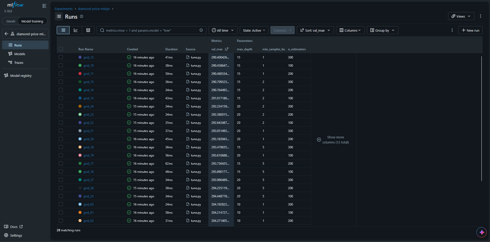
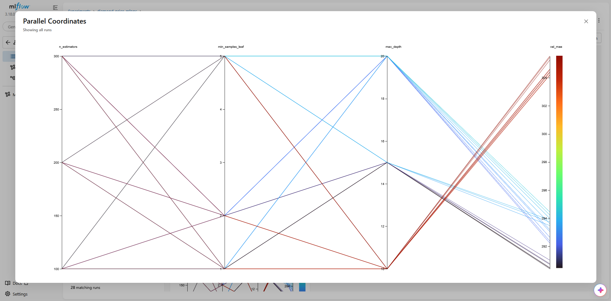
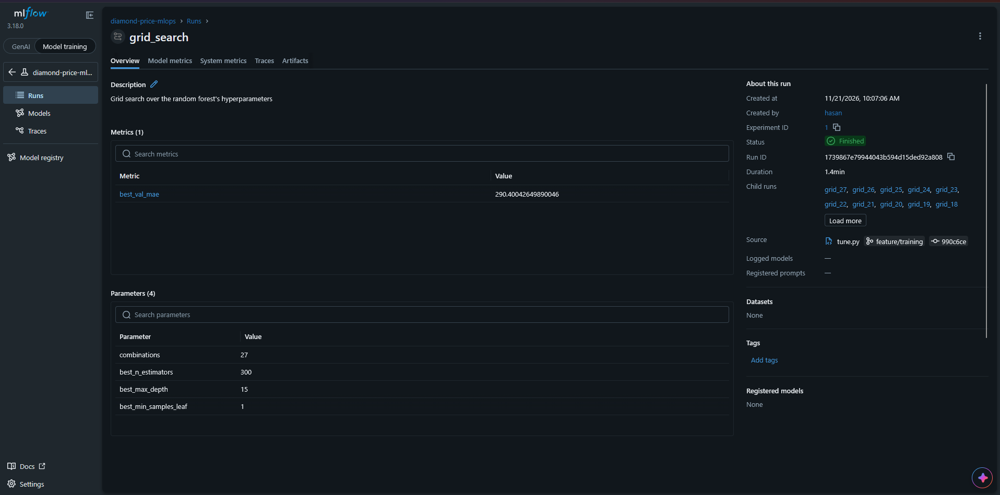

## Evaluation

Final model (`train.py`, best settings from the grid search):

| Set | MAE | RMSE | R² |
| --- | --- | --- | --- |
| Validation | $290.40 | $581.15 | 0.979 |
| **Test** | **$274.84** | **$522.45** | **0.983** |

- On diamonds it never saw, the model's predictions are off by about **$275 on average**, and it explains **98.3%** of the variation in price.
- For comparison, simply guessing the average price for every diamond gives an MAE of about **$3,055**, so the model is more than 10× better than that baseline.
- The test score is close to the validation score, so the model is **not overfitting** to the data used for tuning.
- The validation MAE ($290.40) matches the grid search exactly, which confirms the pipeline is reproducible.

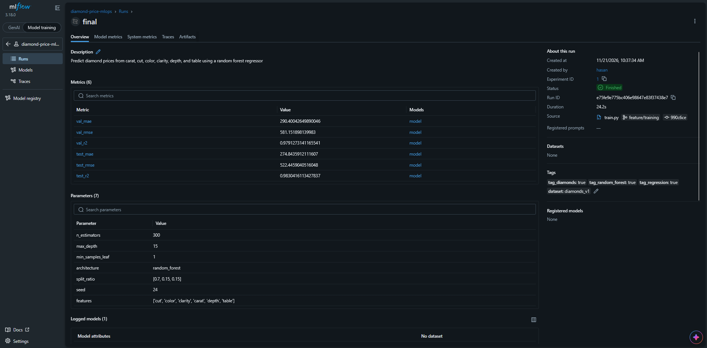
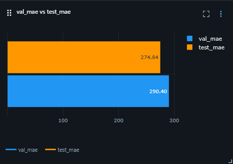

**Limitations:**
- Depth and table barely affect price. For extreme values the model rarely saw (like 50% or 75%), it falls back on the closest training diamonds, so those predictions are less reliable.
- Prices reflect when the dataset was collected, not today's market.

## Experiment Tracking (MLflow)

Every run logs its parameters, metrics, the `config.yaml` file, and (for the final run) the trained model to **MLflow**, stored locally in `mlflow.db`. The screenshots above are from the MLflow dashboard.


To open the dashboard after running `tune.py` or `train.py`:
```
py -3.11 -m mlflow ui --backend-store-uri sqlite:///mlflow.db
```
Then go to http://localhost:5000.

## Cloud Services Used

| Service | What it does in this project |
| --- | --- |
| **Google Cloud Storage** | Stores the clean data (`data/diamonds_clean.csv`) and the trained model (`models/model.joblib`) in the public bucket `diamonds-hasan-aipi510` |
| **Google Cloud Build + Artifact Registry** | Builds the Docker image from the `Dockerfile` and stores it |
| **Google Cloud Run** | Runs the API container with a public URL (region `us-east1`, 2 GB memory). Loads the model from the bucket on startup |
| **Streamlit Community Cloud** | Hosts the public front end, which calls the Cloud Run API |

**Google Cloud project:** `aipi510-diamonds-hasan-mod3`

## API

`src/api.py` is a FastAPI app with two endpoints:

| Endpoint | What it does |
| --- | --- |
| `GET /health` | Returns `{"status": "ok"}` to show the API is running |
| `POST /predict` | Takes one diamond as JSON and returns the predicted price |

Example request (`sample_request.json`):
```json
{"carat": 1.0, "cut": "Ideal", "color": "G", "clarity": "VS2", "depth": 61.8, "table": 57.0}
```
Response:
```json
{"predicted_price": 6267.38}
```

`depth` and `table` are optional (they default to the typical values 61.8 and 57). Invalid inputs, like `"cut": "Amazing"`, are rejected with a 422 error.

The API was tested at every stage with the same request, and returned the same price each time:

| Stage | Screenshot |
| --- | --- |
| Local, FastAPI test page | 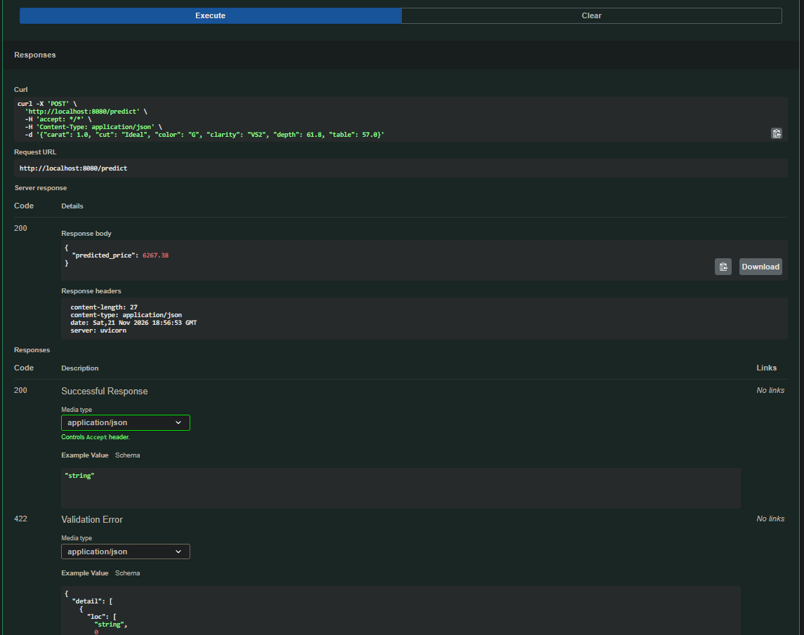 |
| Local, health check | 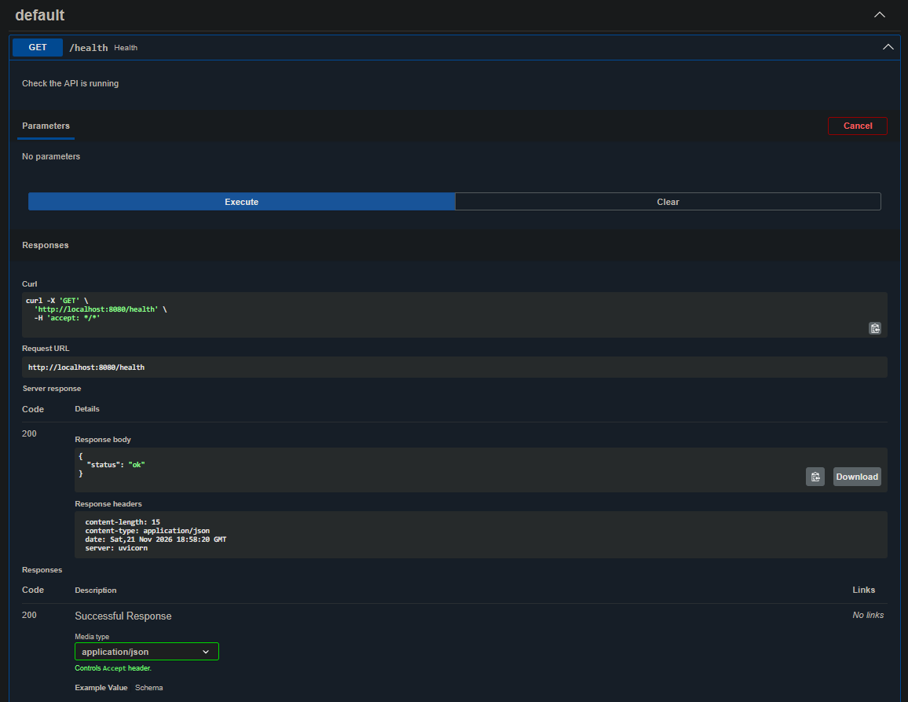 |
| Local, curl | 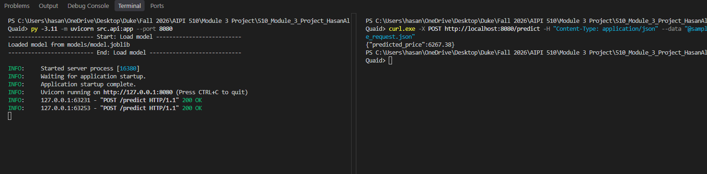 |
| Docker, curl | 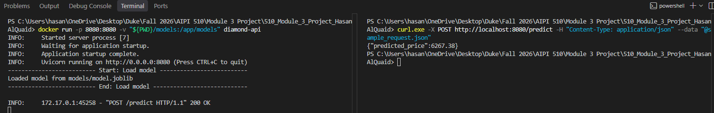 |
| **Cloud Run, HTTPS request** | 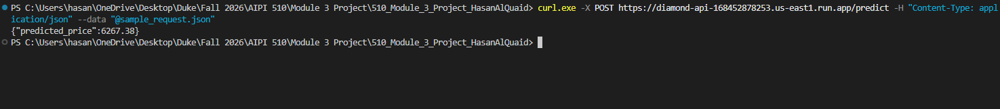 |

## Front End

`frontend/app.py` is a Streamlit page where the user picks a diamond with sliders and clicks **Predict price**. It sends the diamond to the Cloud Run API's `/predict` endpoint with `requests` and shows the price. The front end does not contain the model; every prediction comes from the API.

**Live app:** https://project-diamond-hasan.streamlit.app/

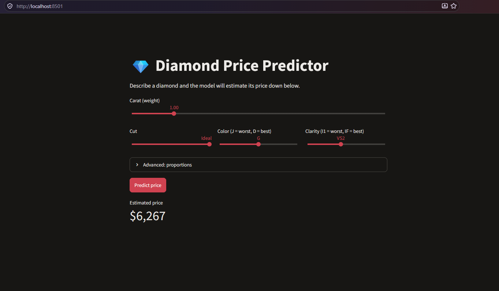

## Project Organization

```
510_Module_3_Project_HasanAlQuaid/
├── data/
│   ├── processed/
│   │   └── diamonds_clean.csv
│   └── raw/
│       └── diamonds.csv
├── frontend/
│   ├── app.py
│   └── requirements.txt
├── images/
│   ├── api_docs_health.png
│   ├── api_docs_predict_1.png
│   ├── api_docs_predict_2.png
│   ├── api_local_curl.png
│   ├── cloud_run_https_request.png
│   ├── docker_local_curl.png
|   |── docker_train.png
│   ├── final_run.png 
│   ├── final_val_vs_test.png
│   ├── grid_search_best.png
│   ├── grid_search_runs.png
│   ├── parallel_coordinates_best.png
│   ├── parallel_coordinates.png
│   └── streamlit_local.png
├── src/
│   ├── api.py
│   ├── prepare_data.py
│   ├── train.py
│   └── tune.py
├── .dockerignore
├── .gitignore
├── config.yaml
├── Dockerfile
├── README.md
├── requirements.txt
└── sample_request.json
```

### Data — `data/`

- **`raw/diamonds.csv`** — the original data downloaded from Hugging Face
- **`processed/diamonds_clean.csv`** — the cleaned data (also stored in the cloud bucket)

### Python scripts — `src/`

- **`prepare_data.py`** — Downloads the raw data, fixes column names and text values, removes impossible and duplicate rows, reports outliers, saves the clean data, and uploads it to Google Cloud Storage
- **`tune.py`** — Grid search: trains 27 models with different hyperparameters, scores them on the validation set only, logs them to MLflow, and prints the best settings
- **`train.py`** — Downloads the clean data, splits it, checks correlations, builds the pipeline (encoding + random forest), trains the final model, scores it on the validation and test sets, logs it to MLflow, and uploads the model to Google Cloud Storage
- **`api.py`** — FastAPI app that loads the model and serves `/health` and `/predict`

### Front end — `frontend/`

- **`app.py`** — Streamlit page that sends user input to the deployed API and shows the prediction
- **`requirements.txt`** — only `streamlit` and `requests`, so the front end stays lightweight

### Other files

- **`config.yaml`** — every setting in one place: data paths, features, split, seed, cloud storage, hyperparameters, grid search values, and MLflow settings
- **`Dockerfile`** — packages the API (serve entry point) and can also run training (train entry point)
- **`.dockerignore`** — keeps data, models, and MLflow files out of the Docker image
- **`sample_request.json`** — example diamond for testing the API
- **`images/`** — screenshots used in this README

## Reproducing My Analysis(Setup)

## Install

This project needs **Python 3.11**. From the repository's main folder, install the required libraries:

```
py -3.11 -m pip install -r requirements.txt
```

| Library | Version |
| --- | --- |
| pandas | 2.3.3 |
| numpy | 2.2.6 |
| scikit-learn | 1.7.2 |
| joblib | 1.6.0 |
| PyYAML | 6.0.3 |
| google-cloud-storage | 3.17.1 |
| mlflow | 3.18.0 |
| fastapi | 0.162.5 |
| uvicorn | 0.54.0 |

The front end uses streamlit 1.67.0 and requests 2.34.2 (`frontend/requirements.txt`).

**Google Cloud access:** the scripts read and write the bucket in `config.yaml`. Log in once with:
```
gcloud auth application-default login
```
To use your own bucket, change `project` and `bucket` under `storage:` in `config.yaml`.

## Usage

Run every script **from the repository's main folder** (not from inside `src/`), in this order.

### How to train the model:

1. `prepare_data.py`
    ```
    py -3.11 src/prepare_data.py
    Outputs: data/raw/diamonds.csv, data/processed/diamonds_clean.csv, uploads the clean data to the bucket
    ```
2. `tune.py`
    ```
    py -3.11 src/tune.py
    Outputs: 27 MLflow runs (grouped under "grid_search"), prints the best hyperparameters
    ```
3. Copy the best hyperparameters into `config.yaml` under `model: hyperparameters:`
4. `train.py`
    ```
    py -3.11 src/train.py
    Outputs: models/model.joblib, uploads the model to the bucket, one MLflow run ("final")
    ```

### How to build and test the API locally:

5. Run the API directly
    ```
    py -3.11 -m uvicorn src.api:app --port 8080
    Then open http://localhost:8080/docs, or in a second terminal:
    curl.exe -X POST http://localhost:8080/predict -H "Content-Type: application/json" --data "@sample_request.json"
    ```
6. Build and run in Docker (serve and train entry points)
    ```
    docker build -t diamond-api .
    Serve (default):  docker run -p 8080:8080 -v "${PWD}/models:/app/models" diamond-api
    Train:            docker run -v "$env:APPDATA\gcloud:/root/.config/gcloud" diamond-api python src/train.py
    Then test the API with the same curl command as step 5
    ```
    The train entry point gives the same results as running `train.py` locally (test MAE $274.84):

    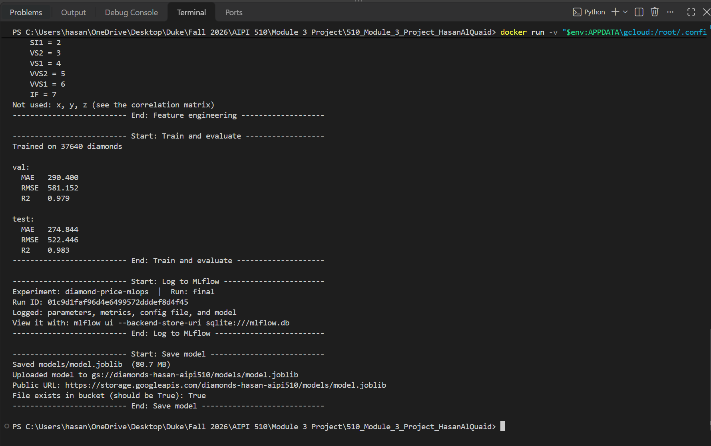

### How to deploy to the cloud:

7. Deploy the API to Cloud Run
    ```
    gcloud services enable run.googleapis.com cloudbuild.googleapis.com artifactregistry.googleapis.com
    gcloud run deploy diamond-api --source . --region us-east1 --memory 2Gi --allow-unauthenticated --set-env-vars MODEL_URI=gs://diamonds-hasan-aipi510/models/model.joblib
    ```
    If the build fails with a permission error, give the project's default compute service account the `roles/run.builder` and `roles/serviceusage.serviceUsageConsumer` roles, wait a few minutes, and run the deploy again.

    Test the deployed API:
    ```
    curl.exe -X POST https://diamond-api-168452878253.us-east1.run.app/predict -H "Content-Type: application/json" --data "@sample_request.json" 
    ```
8. Deploy the front end
    ```
    Test locally: py -3.11 -m streamlit run frontend/app.py
    ```
    Then create an app on [Streamlit Community Cloud](https://share.streamlit.io) from this repository with the main file path `frontend/app.py` and Python 3.11.

To skip retraining, steps 1 to 4 can be skipped: the clean data is already in `data/processed/` and the bucket, and the deployed API already uses the final model.

## Results

- **Best hyperparameters (grid search, 27 models):** `n_estimators` = 300, `max_depth` = 15, `min_samples_leaf` = 1
- **Test set:** MAE **$274.84**, RMSE $522.45, R² **0.983**
- **Baseline (always guess the average price):** MAE about $3,055
- **Deployed:** the API is live on Cloud Run and the front end is live on Streamlit Community Cloud

**Example:** a 1-carat, Ideal cut, color G, VS2 clarity diamond is predicted at **$6,267**.
